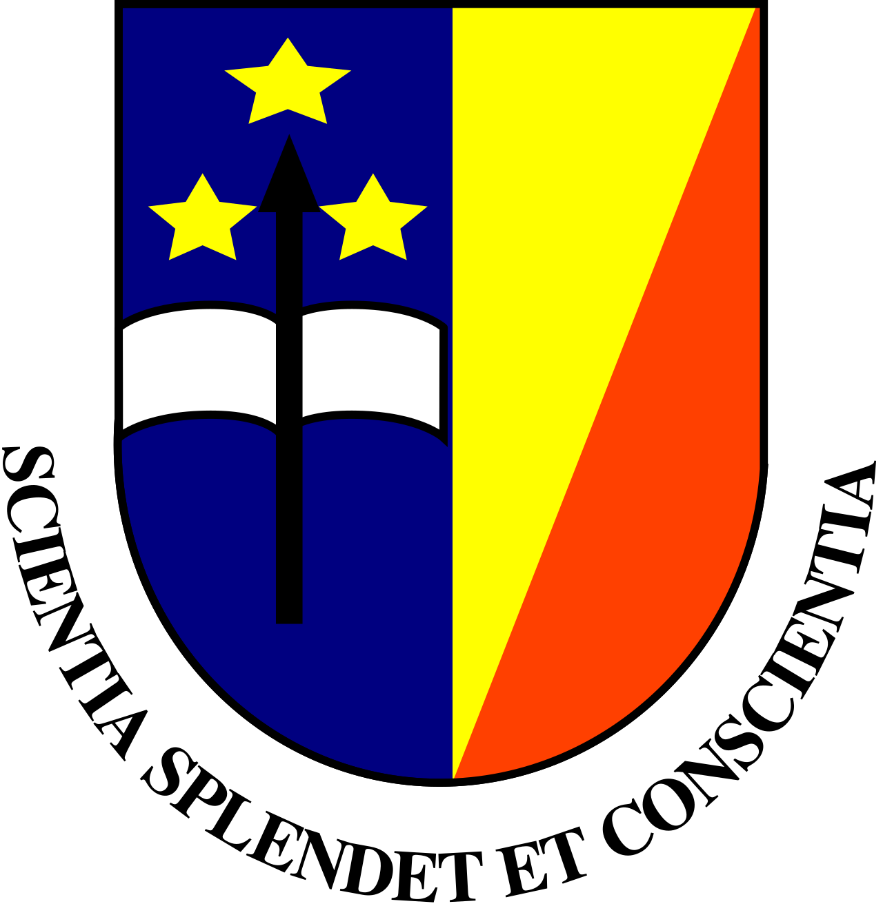

# TFC — Commande vocale embarquée

<p align="center">
  
</p>

Ce dossier regroupe les éléments du projet de fin de cycle consacré à la reconnaissance de commandes vocales et à leur utilisation pour piloter un moteur sur une carte **Arduino Nano 33 BLE Sense**. Le modèle TinyML reconnaît six classes de mots : `down`, `go`, `inconnu`, `left`, `stop` et `up`.

## Contenu

- [`code_python/`](code_python/) : définition du réseau de neurones, entraînement, vérification du modèle et export des filtres Mel.
- [`models/`](models/) : modèles Keras et modèles exportés, regroupés selon leur format ou leur quantification.
- [`c_model/`](c_model/) : code C/C++ lié au modèle.
- [`moteur_voice/`](moteur_voice/) : programme Arduino de capture audio, d’inférence et de commande du moteur. Le fichier `model.h` contient le modèle embarqué et `mel_filterbank.h` les filtres Mel utilis��s par le programme.
- [`simulations/`](simulations/) : fichiers de simulation et schémas électroniques.
- [`rapports/`](rapports/) : rapports, bibliographie, classeurs et ressources associées.
- [`requirements.txt`](requirements.txt) : dépendances Python.

## Environnement Python

Depuis la racine du dépôt, installez les dépendances avec :

```bash
python -m pip install -r tfc/requirements.txt
```

Les dépendances incluent notamment TensorFlow, librosa, NumPy, Matplotlib et scikit-learn. Les scripts Python se trouvent dans `tfc/code_python/` ; consultez leurs commentaires et paramètres pour préparer les données et lancer l’entraînement ou la vérification.

## Fonctionnement embarqué

Le programme [`moteur_voice/moteur_voice.ino`](moteur_voice/moteur_voice.ino) traite le signal du microphone, calcule les caractéristiques audio de type Mel puis exécute l’inférence sur la carte. Les mots reconnus commandent le moteur :

| Mot reconnu | Action prévue |
| --- | --- |
| `up` | Augmente la vitesse en marche avant. |
| `down` | Diminue la vitesse. |
| `left` | Bascule le sens de rotation lorsque le moteur est déjà en marche. |
| `go` | Reprend la direction et la vitesse précédemment mémorisées après un arrêt. |
| `stop` | Arrête le moteur. |
| `inconnu` | Classe de rejet, sans commande moteur dédiée. |

Le programme embarqué utilise les bibliothèques Arduino **PDM**, **CMSIS-DSP** (`arm_math.h`) et **MicroTFLite**. Configurez l’environnement Arduino et les bibliothèques requises pour votre carte avant de téléverser le sketch. Vérifiez également le câblage et le pilote moteur avant tout essai.

## Notes

- Les paramètres audio, le seuil de confiance et les broches de commande sont définis dans `moteur_voice/moteur_voice.ino`.
- Le modèle embarqué et le prétraitement doivent rester compatibles avec le modèle entraîné et ses entrées.
- Les fichiers de simulation et les documents de rapport sont rangés séparément du code d’entraînement et du programme Arduino.
